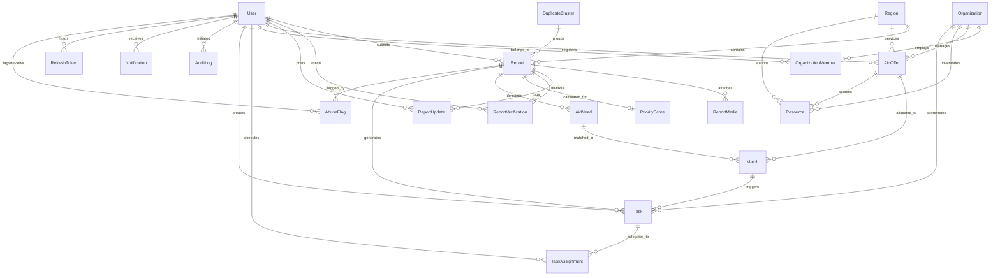
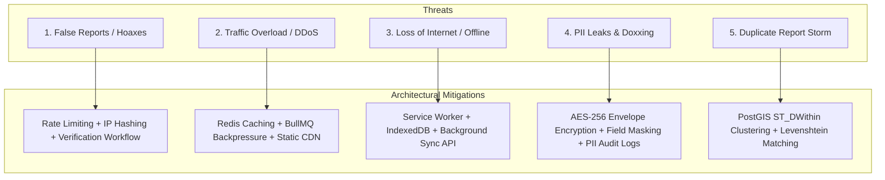

# ReliefLink — Phase 1: Architecture, Data Modeling & Planning Blueprint

## 1. Monorepo Folder Structure

Below is the directory topology for the ReliefLink monorepo, with each directory's operational responsibility defined:

```
/
├── apps/
│   ├── api/                                  # Layered Express Node.js backend with PostGIS, BullMQ, and Socket.IO
│   │   ├── src/
│   │   │   ├── config/                       # Environment variable validation, Redis/Postgres connection pooling
│   │   │   ├── controllers/                  # HTTP request handlers parsing inputs and invoking services
│   │   │   ├── middleware/                   # Auth, RBAC, audit logging, rate limiting, and error handling
│   │   │   ├── routes/                       # Express route declarations with OpenAPI/Zod specs
│   │   │   ├── services/                     # Core business logic: priority scoring, matching, verification
│   │   │   ├── repositories/                 # Data access layer interfacing with Prisma and raw spatial queries
│   │   │   ├── jobs/                         # BullMQ worker processors for deduplication, notifications, queues
│   │   │   ├── sockets/                      # Socket.IO event handlers, channel authorization, and rooms
│   │   │   ├── utils/                        # Geo-helpers, crypto utils, sanitized loggers
│   │   │   └── server.ts                     # App bootstrap and HTTP + WebSocket server initialization
│   │   ├── prisma/                           # Prisma schema, PostGIS extensions, and seed data
│   │   │   ├── schema.prisma                 # Complete data model definition
│   │   │   ├── migrations/                   # Sequential SQL migrations with PostGIS extensions
│   │   │   └── seed.ts                       # Default settings, test accounts, and mock crisis data
│   │   ├── tests/                            # Unit, integration, and API contract test suites
│   │   │   ├── unit/                         # Pure business logic unit tests (scoring, matching algorithms)
│   │   │   ├── integration/                  # Supertest endpoint tests against temporary test database
│   │   │   └── fixtures/                     # Deterministic mock datasets and test users
│   │   └── Dockerfile                        # Multi-stage production container build for API service
│   │
│   └── web/                                  # Next.js App Router client with PWA, MapLibre, and offline support
│       ├── public/                           # Static assets, PWA icons, manifest.webmanifest, and service worker
│       ├── src/
│       │   ├── app/                          # Next.js App Router pages, layout wrappers, and API route proxies
│       │   ├── components/                   # Reusable UI elements (shadcn/ui), forms, maps, and modals
│       │   │   ├── ui/                       # Atomic shadcn/ui components (buttons, dialogs, badges, inputs)
│       │   │   ├── maps/                     # MapLibre GL wrappers, cluster layers, radius rings, pins
│       │   │   ├── reports/                  # Crisis report submission wizards, incident cards, triage lists
│       │   │   └── shared/                   # Emergency top-banners, privacy badges, language toggles
│       │   ├── hooks/                        # TanStack query hooks, geolocation hooks, offline sync hooks
│       │   ├── lib/                          # API client, Socket.IO client, IndexedDB offline cache (idb)
│       │   └── stores/                       # Client-side state stores (Zustand) for filter, draft, and auth
│       ├── tests/                            # React Testing Library component tests and Playwright E2E specs
│       └── Dockerfile                        # Production multi-stage Next.js standalone container
│
├── packages/
│   └── shared/                               # Common TypeScript code shared across api and web
│       ├── src/
│       │   ├── schemas/                      # Zod schemas for request validation and response contracts
│       │   ├── types/                        # Generated/derived TypeScript interfaces and enums
│       │   ├── constants/                    # Role permissions, status enums, priority weight bounds
│       │   └── index.ts                      # Central package barrel export
│       ├── tsconfig.json                     # Shared TypeScript configuration
│       └── package.json                      # Shared library packaging manifest
│
├── infra/                                    # Infrastructure configuration and deployment orchestration
│   ├── docker/                               # Local and staging Docker compose setups
│   │   ├── docker-compose.yml                # Multi-container orchestration (PostGIS, Redis, API, Web, MinIO)
│   │   └── Dockerfile.postgis                # PostGIS image configuration with init scripts
│   ├── nginx/                                # Nginx reverse proxy, SSL termination, and rate limiting config
│   │   └── nginx.conf                        # Gateway routing, WebSocket upgrade, and security headers
│   └── scripts/                              # Maintenance, DB migration, and backup helper scripts
│       └── init-db.sh                        # PostGIS extension installer (`CREATE EXTENSION postgis;`)
│
├── docs/                                     # Project architectural records, API references, runbooks
│   ├── architecture/                         # Architecture decision records (ADRs), schemas, and diagrams
│   └── runbooks/                             # Disaster recovery, deployment, and triage operator manuals
│
├── .github/                                  # CI/CD automation workflows
│   └── workflows/
│       └── ci.yml                            # Automated linting, type-checking, test execution, container builds
├── package.json                              # Monorepo root manifest with Turborepo workspaces and scripts
├── turbo.json                                # Turborepo task pipeline definition
├── tsconfig.json                             # Root TypeScript base compiler configuration
└── .env.example                              # Root environment template documenting required secrets
```

---

## 2. Complete Prisma Schema with PostGIS & Entity Relationships

The schema specifies:
- Direct support for PostGIS geography columns using Prisma's `Unsupported("geography(Point, 4326)")` and `Unsupported("geography(Polygon, 4326)")`.
- Supplementary scalar coordinates (`latitude`, `longitude`) for efficient relational filtering and fast JSON serialization.
- Explicit GIST indexes for spatial speed, B-Tree indexes for status and relation lookups, and compound indexes for common query paths.
- Soft-delete semantics (`deletedAt`) on sensitive operational entities.
- Dynamic `SystemSetting` entity for configurable priority weights and matching thresholds.

```prisma
datasource db {
  provider   = "postgresql"
  url        = env("DATABASE_URL")
  extensions = [postgis]
}

generator client {
  provider        = "prisma-client-js"
  previewFeatures = ["postgresqlExtensions"]
}

// ==========================================
// ENUMS
// ==========================================

enum Role {
  REPORTER
  RESPONDER
  AID_PROVIDER
  COORDINATOR
  ADMIN
}

enum ReportStatus {
  SUBMITTED
  UNDER_REVIEW
  VERIFIED
  REJECTED
  PRIORITIZED
  MATCHED
  IN_PROGRESS
  RESOLVED
  CLOSED
}

enum HazardType {
  FLOOD
  FIRE
  MEDICAL
  MISSING_PERSON
  STRUCTURE_COLLAPSE
  HAZMAT
  UTILITY_FAILURE
  OTHER
}

enum UrgencyLevel {
  LOW
  MEDIUM
  HIGH
  CRITICAL
  LIFE_THREATENING
}

enum VerificationStatus {
  UNVERIFIED
  PENDING
  CONFIRMED
  DISPUTED
  FABRICATED
}

enum VerificationMethod {
  PHONE_CALL
  ON_SITE_VISIT
  OFFICIAL_AGENCY
  PHOTO_METADATA
  CROSS_REPORT_CORROBORATION
}

enum AidType {
  FOOD_WATER
  MEDICAL_SUPPLIES
  SHELTER_BEDDING
  SEARCH_AND_RESCUE
  EVACUATION_TRANSPORT
  EQUIPMENT_TOOLS
  HYGIENE_KIT
  PERSONNEL_VOLUNTEER
}

enum AidStatus {
  AVAILABLE
  COMMITTED
  DEPLETED
  EXPIRED
  SUSPENDED
}

enum NeedUrgency {
  IMMEDIATE   // < 2 hours
  URGENT      // 2 - 12 hours
  STANDARD    // 12 - 48 hours
  FLEXIBLE    // > 48 hours
}

enum MatchStatus {
  PROPOSED
  ACCEPTED_BY_RESPONDER
  DISPATCHED
  FULFILLED
  CANCELLED
  REJECTED
}

enum TaskStatus {
  PENDING
  ASSIGNED
  EN_ROUTE
  ON_SCENE
  COMPLETED
  ABORTED
}

enum TaskPriority {
  LOW
  MEDIUM
  HIGH
  URGENT
}

enum NotificationChannel {
  EMAIL
  SMS
  WEB_PUSH
  IN_APP
}

enum NotificationStatus {
  QUEUED
  SENT
  DELIVERED
  FAILED
}

enum AuditAction {
  READ_PII
  CREATE_REPORT
  UPDATE_REPORT_STATUS
  VERIFY_REPORT
  MATCH_AID
  DISPATCH_TASK
  EXPORT_DATA
  USER_ROLE_CHANGE
  FLAG_ABUSE
  SETTINGS_UPDATE
}

enum AbuseFlagReason {
  SPAM
  FALSE_REPORT
  DUPLICATE
  OFFENSIVE
  MALICIOUS
  OTHER
}

enum AbuseStatus {
  PENDING_REVIEW
  DISMISSED
  CONFIRMED_ABUSE
}

enum OrgType {
  GOVERNMENT_EMERGENCY
  NGO
  VOLUNTEER_GROUP
  CORPORATE_DONOR
  HOSPITAL_CLINIC
}

enum MemberRole {
  OWNER
  MANAGER
  MEMBER
  DISPATCHER
}

// ==========================================
// MODELS
// ==========================================

model User {
  id                    String                @id @default(uuid())
  email                 String?               @unique
  phoneNumber           String?               @unique
  passwordHash          String?               // Null for anonymous or passwordless reporters
  fullName              String?
  role                  Role                  @default(REPORTER)
  isVerifiedResponder   Boolean               @default(false)
  badgeNumber           String?
  lastActiveAt          DateTime?
  createdAt             DateTime              @default(now())
  updatedAt             DateTime              @updatedAt
  deletedAt             DateTime?

  // Relations
  reportsSubmitted      Report[]              @relation("ReporterUser")
  verificationsGiven    ReportVerification[]  @relation("VerifierUser")
  statusUpdates         ReportUpdate[]        @relation("UserUpdates")
  aidOffers             AidOffer[]            @relation("UserAidOffers")
  orgMemberships        OrganizationMember[]
  taskAssignments       TaskAssignment[]      @relation("AssignedUser")
  tasksCreated          Task[]                @relation("TaskCreator")
  auditLogs             AuditLog[]            @relation("AuditedUser")
  notifications         Notification[]
  refreshTokens         RefreshToken[]
  abuseFlagsReported    AbuseFlag[]           @relation("FlagReporter")
  abuseFlagsReviewed    AbuseFlag[]           @relation("FlagReviewer")

  @@index([role])
  @@index([isVerifiedResponder])
  @@index([phoneNumber])
}

model RefreshToken {
  id          String   @id @default(uuid())
  tokenHash   String   @unique
  userId      String
  user        User     @relation(fields: [userId], references: [id], onDelete: Cascade)
  expiresAt   DateTime
  revokedAt   DateTime?
  ipAddress   String?
  userAgent   String?
  createdAt   DateTime @default(now())

  @@index([userId])
}

model Organization {
  id             String               @id @default(uuid())
  name           String
  legalName      String?
  type           OrgType              @default(NGO)
  registrationNo String?              @unique
  isVerified     Boolean              @default(false)
  contactEmail   String
  contactPhone   String
  website        String?
  createdAt      DateTime             @default(now())
  updatedAt      DateTime             @updatedAt
  deletedAt      DateTime?

  // Relations
  members        OrganizationMember[]
  aidOffers      AidOffer[]
  resources      Resource[]
  tasks          Task[]

  @@index([type])
  @@index([isVerified])
}

model OrganizationMember {
  id             String       @id @default(uuid())
  organizationId String
  organization   Organization @relation(fields: [organizationId], references: [id], onDelete: Cascade)
  userId         String
  user           User         @relation(fields: [userId], references: [id], onDelete: Cascade)
  memberRole     MemberRole   @default(MEMBER)
  joinedAt       DateTime     @default(now())

  @@unique([organizationId, userId])
  @@index([userId])
  @@index([organizationId])
}

model Region {
  id          String                                  @id @default(uuid())
  code        String                                  @unique // e.g. "US-FL-MIA"
  name        String
  country     String
  state       String?
  boundary    Unsupported("geography(Polygon, 4326)")?
  centerLat   Float
  centerLng   Float
  isActive    Boolean                                 @default(true)
  createdAt   DateTime                                @default(now())
  updatedAt   DateTime                                @updatedAt

  // Relations
  reports     Report[]
  aidOffers   AidOffer[]
  resources   Resource[]

  @@index([isActive])
}

model Report {
  id                    String                                @id @default(uuid())
  trackingCode          String                                @unique // Public safe alphanumeric tracking code (e.g. RL-8492-X)
  title                 String
  description           String
  hazardType            HazardType
  status                ReportStatus                          @default(SUBMITTED)
  initialUrgency        UrgencyLevel                          @default(MEDIUM)
  
  // Geolocation
  latitude              Float
  longitude             Float
  location              Unsupported("geography(Point, 4326)")?
  approximateLocation   String                                // Obfuscated neighborhood/district level for public
  exactAddressEncrypted String?                               // Encrypted at rest, decrypted only for authorized roles
  
  // Incident details
  peopleAffectedCount   Int                                   @default(1)
  hasInjured            Boolean                               @default(false)
  hasTrapped            Boolean                               @default(false)
  hasVulnerable         Boolean                               @default(false) // Elderly, children, disabled
  vulnerabilityDetails  String?                               // Encrypted details
  
  // Reporter details (Anonymity preserved)
  isAnonymous           Boolean                               @default(false)
  reporterId            String?
  reporter              User?                                 @relation("ReporterUser", fields: [reporterId], references: [id], onDelete: SetNull)
  reporterName          String?                               // Stored if provided anonymously
  reporterPhoneEncrypted String?                              // Encrypted at rest
  reporterIpHash        String?                               // SHA-256 hashed for rate-limiting / anti-spam without storing raw IP

  // Clustering & Verification
  regionId              String?
  region                Region?                               @relation(fields: [regionId], references: [id], onDelete: SetNull)
  duplicateClusterId    String?
  duplicateCluster      DuplicateCluster?                     @relation(fields: [duplicateClusterId], references: [id], onDelete: SetNull)
  isMasterInCluster     Boolean                               @default(false)
  
  createdAt             DateTime                              @default(now())
  updatedAt             DateTime                              @updatedAt
  deletedAt             DateTime?

  // Relations
  media                 ReportMedia[]
  updates               ReportUpdate[]
  verifications         ReportVerification[]
  priorityScore         PriorityScore?
  needs                 AidNeed[]
  tasks                 Task[]
  abuseFlags            AbuseFlag[]

  @@index([status])
  @@index([hazardType])
  @@index([initialUrgency])
  @@index([createdAt])
  @@index([regionId])
  @@index([duplicateClusterId])
  @@index([reporterIpHash])
}

model ReportMedia {
  id              String   @id @default(uuid())
  reportId        String
  report          Report   @relation(fields: [reportId], references: [id], onDelete: Cascade)
  storageKey      String   // S3 key or local fallback path
  fileUrl         String
  mimeType        String
  fileSizeBytes   Int
  isSensitive     Boolean  @default(false) // Flags graphic injuries/fatalities (hidden by default)
  uploadedAt      DateTime @default(now())

  @@index([reportId])
}

model ReportUpdate {
  id          String        @id @default(uuid())
  reportId    String
  report      Report        @relation(fields: [reportId], references: [id], onDelete: Cascade)
  authorId    String?
  author      User?         @relation("UserUpdates", fields: [authorId], references: [id], onDelete: SetNull)
  previousStatus ReportStatus?
  newStatus   ReportStatus?
  note        String        // Public progress update or responder notes
  isPublic    Boolean       @default(true)
  createdAt   DateTime      @default(now())

  @@index([reportId])
  @@index([isPublic])
}

model ReportVerification {
  id          String              @id @default(uuid())
  reportId    String
  report      Report              @relation(fields: [reportId], references: [id], onDelete: Cascade)
  verifiedById String
  verifiedBy  User                @relation("VerifierUser", fields: [verifiedById], references: [id], onDelete: Restrict)
  status      VerificationStatus  @default(PENDING)
  method      VerificationMethod
  notes       String
  confidence  Float               @default(1.0) // 0.0 to 1.0 confidence factor
  verifiedAt  DateTime            @default(now())

  @@index([reportId])
  @@index([verifiedById])
  @@index([status])
}

model DuplicateCluster {
  id              String    @id @default(uuid())
  masterReportId  String?   @unique
  radiusMeters    Float     @default(500.0)
  createdAt       DateTime  @default(now())
  updatedAt       DateTime  @updatedAt

  reports         Report[]

  @@index([createdAt])
}

model PriorityScore {
  id                     String    @id @default(uuid())
  reportId               String    @unique
  report                 Report    @relation(fields: [reportId], references: [id], onDelete: Cascade)
  
  compositeScore         Float     // 0.0 to 100.0
  severityScore          Float     // Raw component
  peopleAffectedScore    Float     // Raw component
  vulnerabilityScore     Float     // Raw component
  waitingTimeScore       Float     // Escalates over time
  verificationMultiplier Float     // Discount for unverified, boost for confirmed
  hazardWeight           Float     // Hazard severity multiplier
  
  calculationBreakdown   Json      // Explanatory JSON for UI explainability
  calculatedAt           DateTime  @default(now())
  updatedAt              DateTime  @updatedAt

  @@index([compositeScore(sort: Desc)])
}

model AidNeed {
  id              String      @id @default(uuid())
  reportId        String
  report          Report      @relation(fields: [reportId], references: [id], onDelete: Cascade)
  aidType         AidType
  quantityRequired Int        @default(1)
  unit            String      // e.g. "liters", "person-meals", "kits", "beds"
  urgency         NeedUrgency @default(URGENT)
  notes           String?
  createdAt       DateTime    @default(now())
  updatedAt       DateTime    @updatedAt

  matches         Match[]

  @@index([reportId])
  @@index([aidType])
  @@index([urgency])
}

model AidOffer {
  id                  String                                @id @default(uuid())
  organizationId      String?
  organization        Organization?                         @relation(fields: [organizationId], references: [id], onDelete: SetNull)
  userId              String?
  user                User?                                 @relation("UserAidOffers", fields: [userId], references: [id], onDelete: SetNull)
  aidType             AidType
  title               String
  description         String?
  capacityTotal       Int
  capacityRemaining   Int
  unit                String
  status              AidStatus                             @default(AVAILABLE)
  
  // Geolocation & Service Coverage
  latitude            Float
  longitude           Float
  location            Unsupported("geography(Point, 4326)")?
  serviceRadiusKm     Float                                 @default(25.0)
  regionId            String?
  region              Region?                               @relation(fields: [regionId], references: [id], onDelete: SetNull)
  
  availableFrom       DateTime                              @default(now())
  availableUntil      DateTime?
  createdAt           DateTime                              @default(now())
  updatedAt           DateTime                              @updatedAt

  matches             Match[]
  resources           Resource[]

  @@index([aidType])
  @@index([status])
  @@index([regionId])
}

model Resource {
  id              String                                @id @default(uuid())
  organizationId  String
  organization    Organization                          @relation(fields: [organizationId], references: [id], onDelete: Cascade)
  aidOfferId      String?
  aidOffer        AidOffer?                             @relation(fields: [aidOfferId], references: [id], onDelete: SetNull)
  name            String
  category        AidType
  quantity        Int
  unit            String
  latitude        Float
  longitude       Float
  location        Unsupported("geography(Point, 4326)")?
  regionId        String?
  region          Region?                               @relation(fields: [regionId], references: [id], onDelete: SetNull)
  isDeployable    Boolean                               @default(true)
  createdAt       DateTime                              @default(now())
  updatedAt       DateTime                              @updatedAt

  @@index([organizationId])
  @@index([category])
  @@index([isDeployable])
}

model Match {
  id                  String       @id @default(uuid())
  needId              String
  need                AidNeed      @relation(fields: [needId], references: [id], onDelete: Cascade)
  offerId             String
  offer               AidOffer     @relation(fields: [offerId], references: [id], onDelete: Cascade)
  matchedQuantity     Int
  compatibilityScore  Float        // 0.0 to 100.0
  distanceMeters      Float
  estimatedTravelMins Float?
  status              MatchStatus  @default(PROPOSED)
  scoreBreakdown      Json         // Explainability metrics
  
  proposedAt          DateTime     @default(now())
  confirmedAt         DateTime?
  fulfilledAt         DateTime?
  cancelledAt         DateTime?

  tasks               Task[]

  @@index([needId])
  @@index([offerId])
  @@index([status])
  @@index([compatibilityScore(sort: Desc)])
}

model Task {
  id              String           @id @default(uuid())
  reportId        String
  report          Report           @relation(fields: [reportId], references: [id], onDelete: Cascade)
  matchId         String?
  match           Match?           @relation(fields: [matchId], references: [id], onDelete: SetNull)
  organizationId  String?
  organization    Organization?    @relation(fields: [organizationId], references: [id], onDelete: SetNull)
  createdById     String
  createdBy       User             @relation("TaskCreator", fields: [createdById], references: [id], onDelete: Restrict)
  
  title           String
  description     String
  priority        TaskPriority     @default(MEDIUM)
  status          TaskStatus       @default(PENDING)
  deadline        DateTime?
  completedAt     DateTime?
  createdAt       DateTime         @default(now())
  updatedAt       DateTime         @updatedAt

  assignments     TaskAssignment[]

  @@index([reportId])
  @@index([status])
  @@index([priority])
  @@index([organizationId])
}

model TaskAssignment {
  id          String    @id @default(uuid())
  taskId      String
  task        Task      @relation(fields: [taskId], references: [id], onDelete: Cascade)
  userId      String
  user        User      @relation("AssignedUser", fields: [userId], references: [id], onDelete: Restrict)
  assignedAt  DateTime  @default(now())
  acceptedAt  DateTime?
  completedAt DateTime?

  @@unique([taskId, userId])
  @@index([taskId])
  @@index([userId])
}

model Notification {
  id          String              @id @default(uuid())
  userId      String
  user        User                @relation(fields: [userId], references: [id], onDelete: Cascade)
  channel     NotificationChannel @default(IN_APP)
  title       String
  body        String
  payload     Json?
  status      NotificationStatus  @default(QUEUED)
  sentAt      DateTime?
  readAt      DateTime?
  createdAt   DateTime            @default(now())

  @@index([userId])
  @@index([status])
  @@index([createdAt])
}

model AuditLog {
  id          String      @id @default(uuid())
  userId      String?
  user        User?       @relation("AuditedUser", fields: [userId], references: [id], onDelete: SetNull)
  userRole    Role?
  action      AuditAction
  entityName  String      // e.g. "Report", "User", "SystemSetting"
  entityId    String
  ipAddress   String?
  userAgent   String?
  metadata    Json?       // e.g. accessed fields like ["exactAddress", "reporterPhone"]
  timestamp   DateTime    @default(now())

  @@index([userId])
  @@index([action])
  @@index([entityName, entityId])
  @@index([timestamp])
}

model AbuseFlag {
  id          String          @id @default(uuid())
  reportId    String
  report      Report          @relation(fields: [reportId], references: [id], onDelete: Cascade)
  reporterId  String?
  reporter    User?           @relation("FlagReporter", fields: [reporterId], references: [id], onDelete: SetNull)
  reason      AbuseFlagReason
  details     String?
  status      AbuseStatus     @default(PENDING_REVIEW)
  reviewedById String?
  reviewedBy  User?           @relation("FlagReviewer", fields: [reviewedById], references: [id], onDelete: SetNull)
  actionNotes String?
  createdAt   DateTime        @default(now())
  reviewedAt  DateTime?

  @@index([reportId])
  @@index([status])
}

model SystemSetting {
  id          String   @id @default(uuid())
  key         String   @unique // e.g. "PRIORITY_WEIGHTS", "MATCHING_WEIGHTS", "DEDUP_RADIUS"
  value       Json     // Flexible configurable parameters
  description String?
  updatedBy   String?
  updatedAt   DateTime @updatedAt
  createdAt   DateTime @default(now())

  @@index([key])
}
```

### Entity Relationship Diagram (Mermaid ERD)



### Relationship Explanation

1. **User to Report (1:N)**: A user can submit multiple reports. When deleted or anonymous, the relation is set to `SetNull` to preserve historical emergency incident records without orphan crashes.
2. **User & Organization to OrganizationMember (M:N via Junction)**: Models responder and NGO affiliation, with granular organizational roles (`OWNER`, `DISPATCHER`, `MEMBER`).
3. **Region to Report & AidOffer (1:N)**: Groups geospatial cases into regional jurisdictions (e.g. Florida South District) for filtered feeds and coordinator boundaries.
4. **DuplicateCluster to Report (1:N)**: Holds related concurrent incident reports. One report can be marked `isMasterInCluster = true`, aggregating child reports into a unified incident thread while keeping individual records.
5. **Report to ReportVerification (1:N)**: An audit trail of verification actions (calls, visits, checks). Multiple responders can verify a report to increase its `confidence` score.
6. **Report to PriorityScore (1:1)**: Each active report has an explainable, updated priority calculation with score decomposition.
7. **Report to AidNeed (1:N) & AidOffer to Match (M:N via Match)**: A report specifies needs (water, rescue boat, medical kits); aid providers publish offers. The `Match` table links an `AidNeed` to an `AidOffer` with quantitative allocation and scoring.
8. **Match to Task (1:N) & Task to TaskAssignment (1:N)**: Once an aid match is accepted by a human responder, operational dispatch tasks are generated and assigned to field responders.
9. **User to AuditLog (1:N)**: Enforces privacy compliance. Every PII read (e.g. looking up a victim's phone number or exact coordinates) writes an immutable record to `AuditLog`.
10. **Report to AbuseFlag (1:N)**: Community and responder spam flagging mechanism to prevent resource poisoning.

---

## 3. Report Lifecycle State Diagram

The report workflow enforces strict state progression. Automated systems calculate scores and propose matches, but state transitions that alter dispatch require human verification.

```mermaid
stateDiagram-v2
    [*] --> SUBMITTED : Anonymous / Registered Reporter submits report
    
    SUBMITTED --> UNDER_REVIEW : Responder opens report for triage
    SUBMITTED --> REJECTED : Responder/Admin flags as spam, hoax, or duplicate
    
    UNDER_REVIEW --> VERIFIED : Responder verifies via phone/photo/cross-check
    UNDER_REVIEW --> REJECTED : Responder confirms invalid or duplicate
    
    VERIFIED --> PRIORITIZED : Engine calculates score; Coordinator confirms triage order
    
    PRIORITIZED --> MATCHED : Engine proposes aid match; Responder/Coordinator accepts
    
    MATCHED --> IN_PROGRESS : Responders accept Task and deploy en route
    
    IN_PROGRESS --> RESOLVED : Field responder completes on-scene mission
    
    RESOLVED --> CLOSED : Coordinator or Admin reviews post-incident log
    
    REJECTED --> UNDER_REVIEW : Coordinator appeals rejection
    RESOLVED --> IN_PROGRESS : Incident recurs or victims re-request aid
    CLOSED --> [*]
```



### State Transitions & Authority Matrix

| Transition | Allowed Roles | Triggering Event / Conditions | Automated Side Effects |
| :--- | :--- | :--- | :--- |
| **[*] $\to$ SUBMITTED** | `PUBLIC`, `REPORTER` | Citizen submits form via web/offline sync. | Generates `trackingCode`, hashes IP, runs duplicate spatial detection, enqueues priority job. |
| **SUBMITTED $\to$ UNDER_REVIEW** | `RESPONDER`, `COORDINATOR`, `ADMIN` | Responder locks case for active verification. | Emits `report:status_changed` via Socket.IO; locks case to prevent duplicate work. |
| **SUBMITTED / UNDER_REVIEW $\to$ REJECTED** | `RESPONDER`, `COORDINATOR`, `ADMIN` | Flagged as hoax, invalid, or obsolete duplicate. | Creates `ReportVerification` (FABRICATED/DISPUTED); cancels scheduled background triage jobs. |
| **UNDER_REVIEW $\to$ VERIFIED** | `RESPONDER`, `COORDINATOR`, `ADMIN` | Attestation via phone call, site photo, or agency. | Computes verification confidence multiplier ($1.0$); triggers priority scoring recalculation. |
| **VERIFIED $\to$ PRIORITIZED** | `RESPONDER`, `COORDINATOR`, `ADMIN` (System proposes) | Priority score approved in triage queue. | Places incident into active regional dispatch board; triggers matching engine job in BullMQ. |
| **PRIORITIZED $\to$ MATCHED** | `RESPONDER`, `COORDINATOR`, `ADMIN` | Human responder confirms proposed Aid Match. | Decrements `capacityRemaining` in `AidOffer`; generates `Task` records for responders. |
| **MATCHED $\to$ IN_PROGRESS** | `RESPONDER`, `COORDINATOR` | Assigned responder team marks status "En Route". | Dispatches push notifications/SMS to reporter tracking link: "Help is on the way." |
| **IN_PROGRESS $\to$ RESOLVED** | `RESPONDER`, `COORDINATOR`, `ADMIN` | Field responder confirms victim safe / aid delivered. | Closes active tasks; releases committed responder availability; prompts reporter feedback. |
| **RESOLVED $\to$ CLOSED** | `COORDINATOR`, `ADMIN` | Formal review, debriefing, and archive. | Archives record; removes incident from active geospatial operational layers. |
| **REJECTED $\to$ UNDER_REVIEW** | `COORDINATOR`, `ADMIN` | New evidence or corroborating reports arrive. | Re-activates triage queue; resets verification status to `PENDING`. |

---

## 4. Priority Scoring Design

### The Explainable Scoring Formula

The priority score $P \in [0, 100]$ determines the order of the triage queue. To ensure complete accountability and auditability, it is computed deterministically from six visible parameters:

$$P = \min\left(100, \; \left[ w_s \cdot S + w_p \cdot f(N) + w_v \cdot V + w_t \cdot g(T) \right] \times H \times C \right)$$

#### Component Definitions:
1. **Severity ($S \in [1, 10]$)**:
   - Based on reported conditions: Structural collapse / active fire ($10$), drowning/trapped ($9$), severe bleeding/medical ($8$), rising floodwaters inside home ($6$), water outage without injuries ($3$), blocked road ($2$).
2. **People Affected Transformation ($f(N) \in [1, 10]$)**:
   - Prevents massive events from skewing the scale linearly while still prioritizing crowds:
     $$f(N) = \min\left(10, \; 1 + 3 \times \log_{10}(N)\right)$$
     - $1\text{ person} \implies 1.0$
     - $10\text{ people} \implies 4.0$
     - $100\text{ people} \implies 7.0$
     - $1000+\text{ people} \implies 10.0$
3. **Vulnerable Groups ($V \in [0, 10]$)**:
   - Additive sum capped at 10:
     - Children present: $+2.5$
     - Elderly present: $+2.5$
     - Trapped / mobility-impaired / disabled: $+3.5$
     - Medical equipment dependence (oxygen, dialysis): $+4.0$
4. **Time Waiting Factor ($g(T) \in [0, 10]$)**:
   - Logarithmic aging curve to prevent low-urgency calls from starving indefinitely:
     $$g(T) = \min\left(10, \; \frac{T_{\text{elapsed\_hours}}}{4}\right)$$
5. **Hazard Multiplier ($H \in [0.8, 1.4]$)**:
   - `FIRE`: $1.4$
   - `FLOOD`: $1.3$
   - `MEDICAL`: $1.3$
   - `STRUCTURE_COLLAPSE`: $1.4$
   - `HAZMAT`: $1.2$
   - `MISSING_PERSON`: $1.1$
   - `UTILITY_FAILURE`: $0.9$
   - `OTHER`: $0.8$
6. **Verification Confidence ($C \in [0.3, 1.0]$)**:
   - Unverified single report: $0.4$
   - Corroborated by duplicate cluster ($\ge 3$ reports): $0.7$
   - Responder phone-verified: $0.9$
   - Official agency or on-scene verified: $1.0$
   - Flagged with dispute / suspicion: $0.2$

### Stored Dynamic Weights & Admin Configuration

Default weights are loaded from `SystemSetting` with key `"PRIORITY_WEIGHTS"`:

```json
{
  "weight_severity": 3.5,
  "weight_people": 2.5,
  "weight_vulnerability": 2.5,
  "weight_waiting_time": 1.5,
  "hazard_multipliers": {
    "FIRE": 1.4,
    "STRUCTURE_COLLAPSE": 1.4,
    "FLOOD": 1.3,
    "MEDICAL": 1.3,
    "HAZMAT": 1.2,
    "MISSING_PERSON": 1.1,
    "UTILITY_FAILURE": 0.9,
    "OTHER": 0.8
  },
  "confidence_ratings": {
    "UNVERIFIED": 0.4,
    "CLUSTER_CORROBORATED": 0.7,
    "PHONE_VERIFIED": 0.9,
    "ON_SITE_VERIFIED": 1.0,
    "DISPUTED": 0.2
  }
}
```

### Explanatory Breakdown Output
Every calculation writes its mathematical audit trail into `PriorityScore.calculationBreakdown`:
```json
{
  "finalScore": 84.7,
  "formula": "min(100, (3.5*8 + 2.5*4.0 + 2.5*6.0 + 1.5*1.2) * 1.3 * 0.9)",
  "components": {
    "severity": { "raw": 8, "weighted": 28.0 },
    "peopleAffected": { "count": 12, "score": 4.0, "weighted": 10.0 },
    "vulnerabilities": { "flags": ["elderly", "trapped"], "score": 6.0, "weighted": 15.0 },
    "waitingHours": 4.8,
    "waitingScore": { "score": 1.2, "weighted": 1.8 }
  },
  "multipliers": {
    "hazardType": "FLOOD (1.3x)",
    "verificationLevel": "PHONE_VERIFIED (0.9x)"
  }
}
```

---

## 5. Aid Matching Design

The matching engine connects an incident's `AidNeed` with the most suitable `AidOffer`.

### Matching Dimensions & Hard Filters (Gating Criteria)
Before scoring, potential candidates must pass non-negotiable gates:
1. **Type Compatibility**: `AidNeed.aidType == AidOffer.aidType`.
2. **Spatial Range Gate**: PostGIS distance check:
   $$\text{ST\_Distance}(Need.location, Offer.location) \le Offer.serviceRadiusKm \times 1000$$
3. **Availability Gate**: `Offer.status == AVAILABLE` and `Offer.capacityRemaining > 0` and current timestamp within `[availableFrom, availableUntil]`.

### Composite Matching Score ($M \in [0, 100]$)

$$M = w_d \cdot S_{\text{dist}} + w_c \cdot S_{\text{cap}} + w_t \cdot S_{\text{readiness}} + w_r \cdot S_{\text{trust}}$$

*Default weights: $w_d = 0.35, \; w_c = 0.30, \; w_t = 0.20, \; w_r = 0.15$*

1. **Distance Score ($S_{\text{dist}} \in [0, 100]$)**:
   Linear decay over service radius:
   $$S_{\text{dist}} = \max\left(0, \; 100 \times \left(1 - \frac{\text{DistanceKm}}{\text{MaxServiceRadiusKm}}\right)\right)$$
2. **Capacity Fulfillment Score ($S_{\text{cap}} \in [0, 100]$)**:
   Measures how well the offer meets the requested quantity:
   - If $\text{OfferCapacity} \ge \text{NeedQuantity} \implies 100\text{ points}$ (full single-provider resolution).
   - If $\text{OfferCapacity} < \text{NeedQuantity} \implies \left(\frac{\text{OfferCapacity}}{\text{NeedQuantity}}\right) \times 80\text{ points}$ (partial aid).
3. **Readiness / Travel Time Score ($S_{\text{readiness}} \in [0, 100]$)**:
   - Ready now ($< 30\text{ mins arrival}): 100$
   - Ready $< 2\text{ hours}: 80$
   - Ready $< 6\text{ hours}: 50$
   - Ready $> 12\text{ hours}: 20$
4. **Provider Trust Score ($S_{\text{trust}} \in [0, 100]$)**:
   - Official Government / Verified Emergency NGO: $100$
   - Vetted Volunteer Group: $85$
   - Unvetted Individual / Corporate Donor: $60$

### Tie-Breaking Hierarchy
When two offers generate equal matching scores ($\Delta M < 0.5$):
1. **Shortest Travel Time** (closest physical proximity).
2. **Single-Source Completeness** (the offer that fulfills 100% of the need without splitting shipments).
3. **Highest Verification Level** of the Aid Provider.
4. **FIFO Registration**: Offer submitted earliest.

### Safety Protocol: Human-in-the-Loop Confirmation
- The matching engine **NEVER** dispatches aid automatically.
- Matches are written with `status: PROPOSED`.
- Responders and Coordinators review matches in their dispatch UI.
- The state only changes to `ACCEPTED_BY_RESPONDER` and triggers task creation when a verified human user clicks "Approve Match".

---

## 6. API Design & Real-Time Specifications

### REST Endpoints (`/api/v1`)

| Method | Endpoint | Allowed Roles | Purpose & Payload Outline |
| :--- | :--- | :--- | :--- |
| **POST** | `/api/v1/auth/register` | `PUBLIC` | Register with email/phone & password. Returns user object. |
| **POST** | `/api/v1/auth/login` | `PUBLIC` | Authenticate user. Sets HTTP-only refresh cookie, returns access JWT. |
| **POST** | `/api/v1/auth/refresh` | `PUBLIC` | Rotates refresh token, returns fresh access JWT. |
| **POST** | `/api/v1/auth/logout` | All authenticated | Revokes active refresh token. |
| **GET** | `/api/v1/auth/me` | All authenticated | Returns profile of current authenticated user. |
| **POST** | `/api/v1/reports` | `PUBLIC`, `REPORTER` | Submit incident report (anonymous or authenticated). Rate-limited. |
| **GET** | `/api/v1/reports` | All roles | Public sees sanitized list; Responders see prioritized queue & PII. |
| **GET** | `/api/v1/reports/:id` | All roles | Get single report. Public sees obfuscated coordinates; logs PII access for responders. |
| **PATCH** | `/api/v1/reports/:id/status`| `RESPONDER`, `COORDINATOR`, `ADMIN` | Transition report state (e.g. UNDER_REVIEW $\to$ VERIFIED). |
| **POST** | `/api/v1/reports/:id/verifications` | `RESPONDER`, `COORDINATOR`, `ADMIN` | Submit verification outcome, confidence, and notes. |
| **POST** | `/api/v1/reports/:id/media` | `PUBLIC`, `REPORTER`, `RESPONDER` | Upload photos/media via pre-signed S3 URL or direct multipart. |
| **POST** | `/api/v1/reports/:id/flag` | `PUBLIC`, `REPORTER`, `RESPONDER` | Flag report as spam, hoax, or offensive. |
| **GET** | `/api/v1/reports/:id/track`| `PUBLIC` | Access incident status via unguessable public tracking code. |
| **POST** | `/api/v1/aid-offers` | `AID_PROVIDER`, `COORDINATOR`, `ADMIN`| Register aid inventory or volunteer capacity. |
| **GET** | `/api/v1/aid-offers` | `AID_PROVIDER`, `RESPONDER`, `COORDINATOR`, `ADMIN` | Search available resources with geospatial radius filters. |
| **PATCH** | `/api/v1/aid-offers/:id` | `AID_PROVIDER` (Owner), `COORDINATOR`, `ADMIN` | Update remaining capacity or operational status. |
| **POST** | `/api/v1/matches/propose` | `RESPONDER`, `COORDINATOR`, `ADMIN` | Run on-demand matching algorithm for a report need. |
| **POST** | `/api/v1/matches/:id/confirm` | `RESPONDER`, `COORDINATOR`, `ADMIN` | Human confirmation of match. Transitions to `ACCEPTED`. |
| **POST** | `/api/v1/tasks` | `RESPONDER`, `COORDINATOR`, `ADMIN` | Create dispatch task linked to report and match. |
| **PATCH** | `/api/v1/tasks/:id/status` | `RESPONDER` (Assignee), `COORDINATOR`, `ADMIN` | Update task status (EN_ROUTE, ON_SCENE, COMPLETED). |
| **GET** | `/api/v1/regions` | All roles | List disaster regions and bounding boxes for map viewport. |
| **GET** | `/api/v1/audit-logs` | `ADMIN` | View tamper-evident log of all PII accesses and status changes. |
| **GET** | `/api/v1/admin/settings` | `ADMIN` | Retrieve priority weights and system configuration. |
| **PUT** | `/api/v1/admin/settings` | `ADMIN` | Update dynamic weights with validation. |

### Socket.IO Real-Time Architecture

#### Connection & Authentication
- Socket handshakes authenticate via JWT bearer token in query/auth headers.
- Anonymous clients connect with read-only public room subscription capabilities.

#### Channel & Room Structure
- `region:{regionId}`: Geographically partitioned channel for local updates.
- `report:{reportId}`: Incident-specific updates for users tracking a specific report.
- `responders:{regionId}`: Private operational channel restricted to verified responders.
- `user:{userId}`: Personal inbox for notifications, task assignments, and alerts.

#### Event Catalog

| Event Name | Direction | Payload | Intended Audience |
| :--- | :--- | :--- | :--- |
| `subscribe:region` | Client $\to$ Server | `{ regionId: string }` | Map clients tracking a jurisdiction |
| `subscribe:report` | Client $\to$ Server | `{ trackingCode: string }` | Reporter or family tracking a case |
| `report:created` | Server $\to$ Client | `{ report: SanitizedReport }` | Broadcast to `region:{regionId}` |
| `report:status_changed`| Server $\to$ Client | `{ reportId, oldStatus, newStatus, trackingCode }` | Broadcast to region and report rooms |
| `report:priority_updated` | Server $\to$ Client | `{ reportId, compositeScore, breakdown }` | `responders:{regionId}` room only |
| `aid:match_proposed` | Server $\to$ Client | `{ matchId, needId, offerId, score }` | Responders and relevant Aid Provider |
| `task:assigned` | Server $\to$ Client | `{ taskId, title, priority, reportLocation }` | Emitted to specific assigned `user:{userId}` |
| `task:status_changed` | Server $\to$ Client | `{ taskId, newStatus, timestamp }` | Broadcast to responder team channel |
| `alert:broadcast` | Server $\to$ Client | `{ severity, message, polygon }` | Global emergency broadcast to all rooms |

---

## 7. Data Privacy & RBAC Visibility Matrix

To protect vulnerable citizens in crisis, personal identifiable information (PII) is concealed from the public and revealed only to authenticated, verified responders who need it for aid delivery.

| Field / Asset | Public / Anonymous Guest | Registered Reporter (Own Report) | Registered Reporter (Other Reports) | Aid Provider | Verified Responder | Regional Coordinator | System Admin |
| :--- | :---: | :---: | :---: | :---: | :---: | :---: | :---: |
| **Report Title & Hazard Type** | Full | Full | Full | Full | Full | Full | Full |
| **Report Status & Tracking Code**| Full | Full | Full | Full | Full | Full | Full |
| **Approximate Location (City/District)** | Visible | Visible | Visible | Visible | Visible | Visible | Visible |
| **Exact GPS Coordinates** | Redacted (Jittered $\pm 500\text{m}$) | Full | Redacted | Redacted | **Full** (Logged) | **Full** (Logged) | **Full** (Logged) |
| **Exact Street Address** | Hidden | Full | Hidden | Hidden | **Full** (Logged) | **Full** (Logged) | **Full** (Logged) |
| **Reporter Name** | Hidden | Full | Hidden | Hidden | **Full** (Logged) | **Full** (Logged) | **Full** (Logged) |
| **Reporter Phone Number** | Hidden | Full | Hidden | Hidden | **Full** (Logged) | **Full** (Logged) | **Full** (Logged) |
| **Vulnerability & Medical Notes** | Hidden | Full | Hidden | Needs Only | **Full** (Logged) | **Full** (Logged) | **Full** (Logged) |
| **General Photos / Media** | Visible | Visible | Visible | Visible | Visible | Visible | Visible |
| **Sensitive Photos (Casualties/IDs)**| Blurred / Hidden | Full | Hidden | Hidden | **Full** (Logged) | **Full** (Logged) | **Full** (Logged) |
| **Internal Responder Notes** | Hidden | Hidden | Hidden | Hidden | Visible | Visible | Visible |
| **Priority Score Breakdown** | Hidden | Hidden | Hidden | Hidden | Visible | Visible | Visible |

### Mandatory Audit Logging Rule
Any endpoint or service method that accesses or displays an unmasked PII field (`exactAddressEncrypted`, `reporterPhoneEncrypted`, `latitude`/`longitude`, or `isSensitive` media) executes within a transaction that creates an `AuditLog` entry:
- Captures: `userId`, `userRole`, `action: READ_PII`, `entityId: reportId`, `metadata: { accessedFields: ["phone", "exact_address"] }`, `timestamp`, `ipAddress`.
- Tamper prevention: `AuditLog` records have no update or delete routes in the API.

---

## 8. Top 10 Risks & Engineered Mitigations



### Risk Analysis & Mitigations

1. **Malicious False Reports and Coordinated Spam**
   - *Risk*: Bad actors flood the portal with fake emergencies to divert first responders away from real crises.
   - *Mitigation*: Rate limit by IP hash and browser fingerprint; initial state is always `SUBMITTED` (unverified); responders must confirm reports before dispatch; community abuse flagging mechanism drops priority scores of disputed reports.

2. **System Overload and Traffic Surges During Disasters**
   - *Risk*: A sudden hurricane or earthquake causes a 100x spike in traffic, crashing the API.
   - *Mitigation*: Public GET endpoints are heavily cached in Redis (with 5-second TTL micro-caching); heavy operations (scoring, duplicate clustering, notification delivery) are offloaded to BullMQ background workers; edge-cached static assets via Nginx/Cloudflare.

3. **Intermittent or Total Loss of Internet in the Disaster Zone**
   - *Risk*: Victims and field rescue teams cannot connect to the API due to downed cell towers.
   - *Mitigation*: PWA with Service Worker and local storage via IndexedDB; offline report creation with cryptographic queue; automatic background sync when connectivity resumes; SMS gateway fallback for low-bandwidth reporting.

4. **Privacy Leaks of Victims' Sensitive Data and Locations**
   - *Risk*: Vulnerable citizens (e.g. domestic shelter residents, unattended minors) are exposed on a public map.
   - *Mitigation*: Public map layers jitter coordinates by $\pm 500$ meters; exact street addresses and phone numbers are encrypted at rest with AES-256; only verified responders can view raw PII; every PII view triggers an immutable `AuditLog`.

5. **Duplicate Report Storms for High-Visibility Incidents**
   - *Risk*: 50 people report the same burning building, cluttering the triage queue and splitting responder resources.
   - *Mitigation*: Automated spatial deduplication job using PostGIS: `ST_DWithin(geom, 500m)` executed on submission; matching hazard types within 30 minutes are grouped under a `DuplicateCluster`; one master record is displayed with a badge ("50 corroborating reports").

6. **Aid Misallocation and Ghost Inventory**
   - *Risk*: An NGO pledges 500 blankets, but another team claims them first, resulting in zero deliveries to freezing victims.
   - *Mitigation*: Two-phase aid allocation with database locks: aid reservations decrement `capacityRemaining` conditionally in a PostgreSQL transaction (`WHERE capacityRemaining >= requested`); offers expire automatically if not accepted within a configurable time window.

7. **Unauthorized or Erroneous Automated Dispatch**
   - *Risk*: An algorithm sends rescue boats to an unverified location without human validation.
   - *Mitigation*: System hard-gate: the engine creates matches in `PROPOSED` status only; only human `RESPONDER` or `COORDINATOR` roles can execute a dispatch action.

8. **Priority Inversion and Starvation of Remote Cases**
   - *Risk*: High-density urban incidents crowd out single victims trapped in isolated rural zones.
   - *Mitigation*: Explainable priority formula includes a logarithmic waiting-time aging term $g(T)$; as time passes, the waiting factor steadily escalates the case's priority in the queue.

9. **Cloud Provider Outage or Infrastructure Failure**
   - *Risk*: S3 or managed cloud services fail during an ongoing regional catastrophe.
   - *Mitigation*: Monorepo Docker Compose stack provides pluggable storage: S3-compatible production storage with automatic fallback to local directory volume mounts; self-hosted PostGIS and Redis instances.

10. **Responder Fatigue, Chaos, and Duplicate Dispatch**
    - *Risk*: Two different rescue units independently deploy to the same house without knowing the other is en route.
    - *Mitigation*: Real-time WebSocket presence updates; when a responder opens a case, it enters `UNDER_REVIEW` with an active responder lock; active tasks display live unit assignments.

---

## 9. Comprehensive Build Checklist (Phases 2 to 9)

- [ ] **Phase 2: Monorepo Foundation & Docker Environment**
  - Turborepo configuration (`turbo.json`) and pnpm workspaces.
  - Multi-container Docker Compose setup (`postgres-postgis`, `redis`, `minio-s3`, `mailpit`).
  - `@relieflink/shared` package initialization with TypeScript configs.
  - Base Prisma migrations enabling PostGIS extension and seeding system settings.

- [ ] **Phase 3: Backend Core, Auth & Security**
  - Layered Express architecture: routes $\to$ controllers $\to$ services $\to$ repositories.
  - JWT authentication with secure HTTP-only refresh token rotation.
  - Server-side RBAC middleware (`REPORTER`, `RESPONDER`, `AID_PROVIDER`, `COORDINATOR`, `ADMIN`).
  - Cryptographic helpers for PII encryption at rest (AES-256-GCM).
  - Immutable audit logging middleware for all PII access events.

- [ ] **Phase 4: Crisis Report Ingestion & Geospatial Processing**
  - Public reporting endpoints with strict Zod validation schemas.
  - Emergency disclaimer enforcement on all submission routes.
  - PostGIS spatial repository: `ST_MakePoint`, `ST_DWithin`, and spatial GIST indexing.
  - BullMQ deduplication worker: automatic clustering of reports within spatial-temporal windows.
  - File upload service (S3-compatible with local disk fallback) with image dimension and metadata sanitization.

- [ ] **Phase 5: Verification & Explainable Priority Engine**
  - Verification API for responders (attestation types, confidence scores).
  - Configurable priority scoring service implementing the explainable mathematical formula.
  - Admin settings API to dynamically adjust weights without redeploying.
  - Prioritized triage queue endpoints with sorting and filtering by region and hazard.

- [ ] **Phase 6: Aid Registry & Matching Engine**
  - Aid offer and resource registry CRUD with capacity tracking.
  - Geospatial matching algorithm: category matching, distance decay, and capacity scoring.
  - Database transactional commitment for aid reservations to prevent double-allocation.
  - Human-in-the-loop responder match approval workflow.

- [ ] **Phase 7: Real-Time Coordination & Dispatch Engine**
  - Socket.IO server initialization with authenticated channel rooms (`region`, `report`, `responders`).
  - Live incident lifecycle event broadcasts (`report:created`, `status_changed`, `priority_updated`).
  - Field task dispatching and assignment system (`Task` and `TaskAssignment`).
  - Responder presence tracking and case lock mechanism to eliminate duplicate efforts.

- [ ] **Phase 8: Frontend Application (Next.js PWA & MapLibre)**
  - Next.js App Router setup with Tailwind CSS and shadcn/ui.
  - Persistent, non-dismissible 911 emergency banner across all public pages.
  - PWA configuration: `manifest.webmanifest`, Service Worker, and IndexedDB draft queue for offline reporting.
  - MapLibre GL interactive map: marker clustering, radius overlays, and privacy-jittered public pins.
  - Responder triage dashboard with real-time incident feeds and explainable score breakdowns.

- [ ] **Phase 9: Notifications, Testing & Production Hardening**
  - Multichannel notification service: SMTP (Mailpit/SendGrid), SMS sandbox provider, and Web Push.
  - Automated test suites: Vitest unit tests, Supertest API integration tests, and Playwright E2E triage workflows.
  - Nginx reverse proxy configuration with rate-limiting, gzip/brotli compression, and CSP headers.
  - CI/CD pipeline via GitHub Actions for automated linting, test execution, and container verification.
